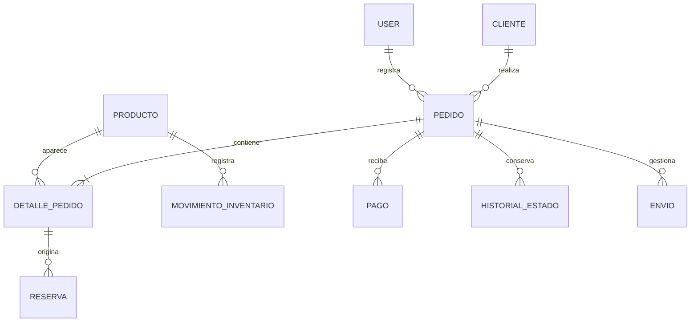

# Arquitectura y DER conceptual

Monolito Laravel MVC + Blade + Bootstrap 5 + JavaScript/Fetch + MySQL. Laravel 12 por PHP 8.2; revisar actualización/soporte futuro. Vite construye recursos; archivos lock compartidos. Sesiones/cache en archivos y cola síncrona para un servidor inicial. Sin React/Vue, API pública o WebSockets.

Flujo: navegador → rutas/middleware → controlador/validación → acción de negocio → Eloquent/MySQL → Blade/JSON. Controladores breves, Form Requests en módulos, acciones futuras en `app/Acciones/`, Policies cuando se acuerden permisos. Archivos propios en español, convenciones Laravel preservadas.

Autenticación con sesión, sin registro público; `User`, `users` y campos de autenticación predeterminados conservados. Fetch no garantiza sincronía instantánea entre pantallas: la disponibilidad se revalida al confirmar en servidor.

## DER inicial, no tablas implementadas

Producto: código/descripción/costo/precio. Cliente: contacto. Pedido: modalidad/estado. Detalle: cantidad y valores históricos. Reserva: tipo/cantidad/estado. Pago: importe/referencia. Envio: transportista/seguimiento. Movimiento: cantidad/tipo/motivo. Historial: estado/fecha/responsable.

Cada código representa una pieza física, con existencia 0/1, según decisión del encargado. La cardinalidad de envíos continúa pendiente.

## Inventario implementado

Además de las tablas estándar Laravel, existen `productos` y `movimientos_inventario`: Producto 1:N MovimientoInventario, User 1:N MovimientoInventario. Las claves `producto_id` y `usuario_id` restringen el borrado del historial. Índice único en código y referencia de movimiento. Costos/precios DECIMAL(10,2); activo y versión en producto. MySQL/MariaDB aplica CHECK de existencia 0/1 y consistencia antes/cambio/después.

`GestionarInventario` realiza cambios con transacciones y bloqueo de fila. La edición valida versión; la baja es desactivación sin borrar piezas. Una pieza reservada no admite ajustes manuales ni desactivación.

## Pedidos implementados — 2026-11-02

Cliente 1:N Pedido; Pedido 1:N DetallePedido/Reserva/EventoPedido/Pago. Cada detalle representa una pieza y conserva código/nombre/costo/precio. Una reserva retiene producto_id histórico y producto_bloqueado_id nullable único para bloquear disponibilidad. Confirmación/cancelación/devolución transaccionales con bloqueos y orden consistente. Mínimo histórico del 25 % por pedido y cálculo en centavos enteros.

La tabla/modelo Pago es contrato compartido; su interfaz, registro/verificación y ciclo de entregas se desarrollarán aparte. Ver PEDIDOS_Y_RESERVAS.md y CONTRATO_PAGOS.md. El diagrama conceptual anterior conserva Envio/HISTORIAL_ESTADO como entidades futuras: historial comercial actual usa eventos_pedido.

Pruebas de acceso/reglas: SQLite en memoria. Concurrencia de inventario y pedidos comprobada con conexiones independientes MariaDB e InnoDB sobre tablas clonadas aisladas. MySQL 8 todavía no probado.
