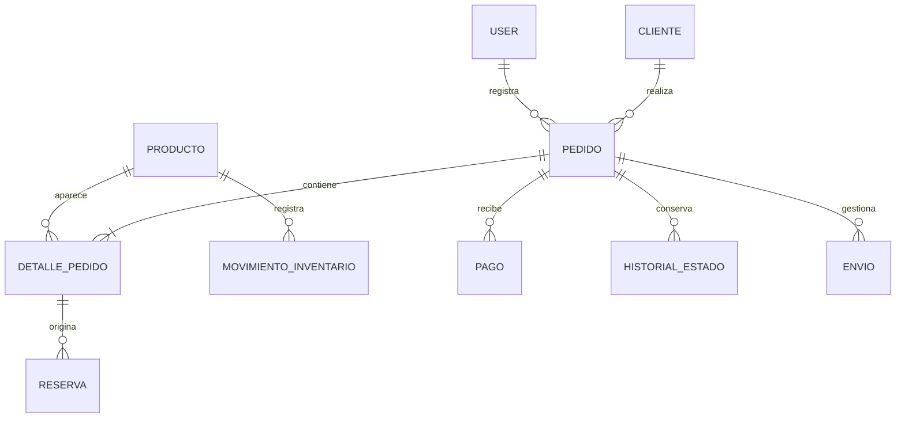

# Arquitectura y DER conceptual

Monolito Laravel MVC + Blade + Bootstrap 5 + JavaScript/Fetch + MySQL. Laravel 12 por PHP 8.2; revisar actualización/soporte futuro. Vite construye recursos; archivos lock compartidos. Sesiones/cache en archivos y cola síncrona para un servidor inicial. Sin React/Vue, API pública o WebSockets.

Flujo: navegador → rutas/middleware → controlador/validación → acción de negocio → Eloquent/MySQL → Blade/JSON. Controladores breves, Form Requests en módulos, acciones futuras en `app/Acciones/`, Policies cuando se acuerden permisos. Archivos propios en español, convenciones Laravel preservadas.

Autenticación con sesión, sin registro público; `User`, `users` y campos de autenticación predeterminados conservados. Fetch no garantiza sincronía instantánea entre pantallas: la disponibilidad se revalida al confirmar en servidor.

## DER inicial, no tablas implementadas

Producto: código/descripción/costo/precio. Cliente: contacto. Pedido: modalidad/estado. Detalle: cantidad y valores históricos. Reserva: tipo/cantidad/estado. Pago: importe/referencia. Envio: transportista/seguimiento. Movimiento: cantidad/tipo/motivo. Historial: estado/fecha/responsable.

Validar cardinalidad de envíos y piezas/cantidades antes del esquema final. Solo están migraciones estándar Laravel; actualizar DER según implementación.

Pruebas de acceso: SQLite en memoria. Concurrencia futura: MySQL y conexiones independientes, no asumir que SQLite demuestra bloqueo InnoDB.
