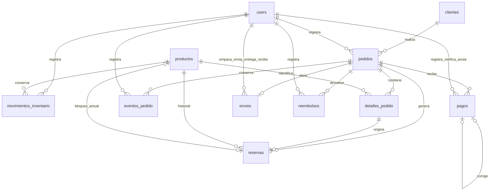

# Modelo de datos final

Fuente: migraciones de `database/migrations`. Actualizado: 2026-11-03. Nombres del diagrama corresponden a tablas reales.

El borrador puede tener cero detalles; la confirmación exige piezas válidas. Las relaciones múltiples de responsables a users se resumen gráficamente y se detallan a continuación.

| Tabla | Contenido y claves relevantes |
|---|---|
| users | Nombre, correo único, contraseña hash, rol, activo, desactivado_en, remember_token |
| clientes | Nombre, teléfono, correo, dirección y deleted_at para baja lógica |
| productos | Código único, nombre, descripción, costo/precio DECIMAL, existencia 0/1, activo, versión |
| movimientos_inventario | producto_id, usuario_id, referencia única, tipo, cantidad, existencias antes/después, motivo |
| pedidos | Referencia única, cliente_id, usuario_id, copia histórica de contacto, modalidad, estado comercial/logístico, total, porcentaje de depósito, versión y fechas |
| detalles_pedido | pedido_id, producto_id, código/nombre/costo/precio históricos, version_producto; pareja pedido/producto única |
| reservas | pedido_id, detalle_pedido_id único, producto_id histórico, producto_bloqueado_id nullable único, tipo, estado y liberada_en |
| eventos_pedido | pedido_id, usuario_id, tipo, descripción y fechas |
| pagos | pedido_id, usuario_id, monto, método, referencia, fecha_pago, verificado_por/en, anulado_por/en, motivo_anulacion, corrige_pago_id nullable único, observaciones y clave_operacion única |
| envios | pedido_id único, destinatario, teléfono, dirección, transportista, guía, observaciones; empacado/enviado/entregado/devuelto_por y sus fechas |
| reembolsos | pedido_id, usuario_id, monto, método, referencia, fecha_reembolso, motivo y clave_operacion única |

## Integridad y conservación

- Las FK comerciales restringen el borrado; clientes usa baja lógica y usuarios/productos desactivación.
- Una reserva guarda el producto histórico y un segundo identificador nullable único que impide dos bloqueos actuales sobre la misma pieza. Liberar elimina ese bloqueo, no el historial.
- Cantidades de dinero se almacenan en DECIMAL y se calculan en centavos. Cada detalle representa una pieza física.
- La salida física se registra al enviar; la confirmación de regreso registra entrada. Las operaciones usan transacciones, bloqueo de filas, versiones y referencias únicas según el caso.
- Las correcciones enlazan el pago reemplazante con el original; los reembolsos tienen tabla propia y no se representan con pagos negativos.
- La migración puente conserva columnas legacy importe/fecha cuando existían previamente. Una instalación nueva no debe depender de esos campos.

## Tablas de infraestructura

`migrations`, `password_reset_tokens`, `sessions`, `cache`, `cache_locks`, `jobs`, `job_batches` y `failed_jobs` corresponden a infraestructura Laravel. En Render se utilizan sesiones y caché de base de datos y cola síncrona. La configuración puede conservar tablas de colas sin utilizarlas como procesamiento asíncrono.

Para una entrega gráfica, exportar este Mermaid a imagen o PDF y comprobar legibilidad. No se adjunta una imagen exportada en esta versión Markdown.
